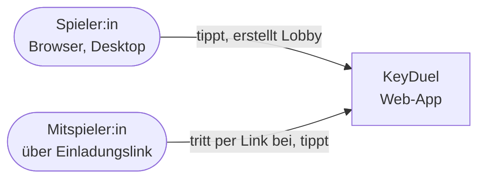
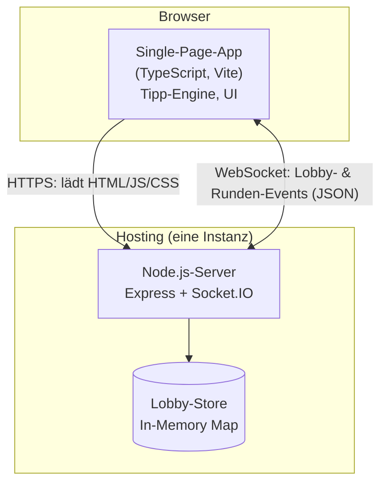
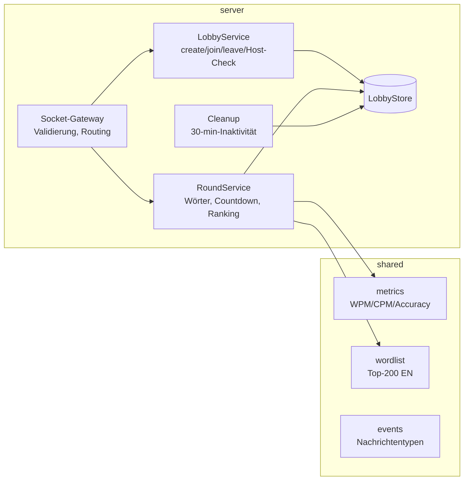
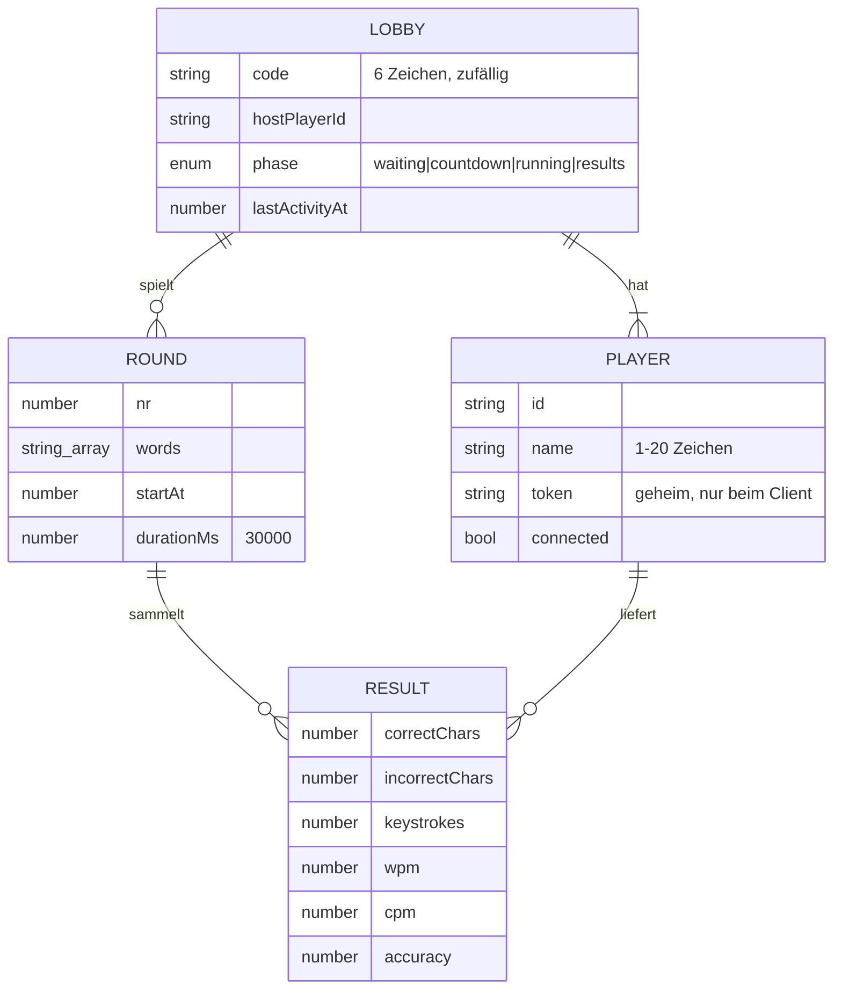
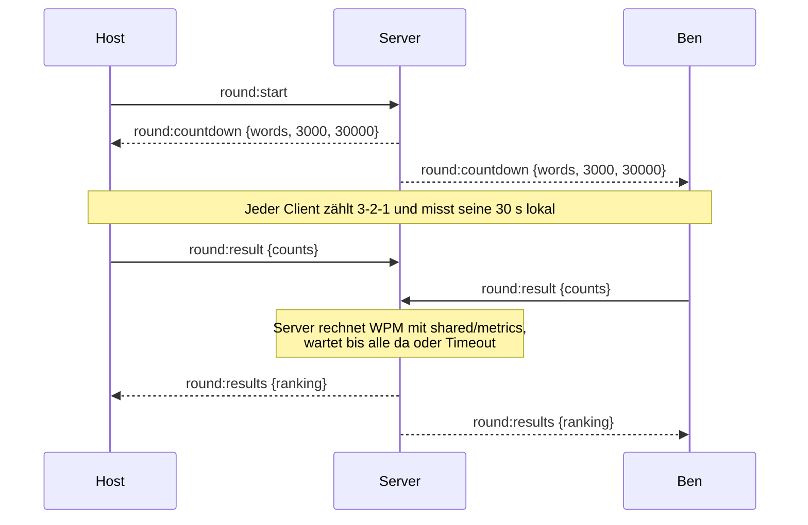

# AI-Input Phase 2 – Architekturvorschläge (KeyDuel)

> **Status: Rohmaterial von der AI (Claude Opus 5.5), keine Entscheidung.**
> Alles hier sind Vorschläge. Was davon in `architecture.md`, `hosting.md` und `adr/` landet, entscheidet das Team.
> Grundlage: [requirements.md](../requirements.md), [mvp.md](../mvp.md).

---

## 1. Was die Anforderungen für die Architektur bedeuten

| Anforderung | Folge für die Architektur |
|---|---|
| US-01–03, NFR-01 (≤ 50 ms) | Der Einzelspieler läuft **komplett im Browser**. Kein Server-Roundtrip pro Tastendruck. |
| US-04/05, NFR-02 (≤ 2 s) | Für den Multiplayer braucht es einen **Echtzeit-Kanal** (Push vom Server). Reines HTTP-Polling geht, ist aber umständlich. |
| NFR-04 (nur Name, Löschung nach 30 min) | **Keine dauerhafte Datenbank nötig.** Lobbys können im Arbeitsspeicher liegen. |
| NFR-05 (Unit-Tests der Formeln) | Die Berechnung sollte ein **eigenes, reines Modul** sein (ohne UI, ohne Netzwerk). |
| NFR-06 (Gratis-Hosting) | Free Tier muss **dauerhafte WebSocket-Verbindungen** erlauben. Das schließt reine Serverless-Funktionen aus. |
| „Host über Browser-Sitzung“ | Der Server gibt beim Erstellen/Beitreten ein **zufälliges Token** aus, das im `sessionStorage` liegt. |
| Max. 8 Personen, Semesterprojekt | Eine **einzelne Server-Instanz** reicht. Skalierung ist kein Thema. |

---

## 2. Architekturvarianten

### Variante A – Modularer Monolith (Node.js + WebSocket, In-Memory)

Ein einziger Node.js-Prozess liefert das gebaute Frontend aus und betreibt den WebSocket-Server. Lobbys liegen in einer `Map` im Speicher.

```
Browser (SPA) ──HTTP──▶ Node-Server ──▶ statische Dateien
          └────WebSocket────▶ Lobby-Modul (Map<code, Lobby>)
```

- ➕ Ein Deployment, eine Sprache (TypeScript) für Client und Server. Formeln und Nachrichtentypen können geteilt werden.
- ➕ Server ist Autorität: Er erzeugt die Wörter, prüft „nur Host startet“, sammelt Ergebnisse.
- ➕ Keine DB, keine Fremddienste → wenig, was kaputtgehen kann.
- ➖ Server-Neustart = alle Lobbys weg (für 30-min-Lobbys vertretbar).
- ➖ Nur eine Instanz möglich (In-Memory-State). Für 8er-Lobbys irrelevant.
- ➖ Free-Tier-Hoster mit „Sleep“ → erster Aufruf kann langsam sein (siehe Hosting).

### Variante B – Statisches Frontend + Backend-as-a-Service (z. B. Firebase Realtime Database / Supabase Realtime)

Kein eigener Server. Frontend auf einem Static Host, Lobby-Zustand in einem gehosteten Realtime-Dienst. Die Clients schreiben direkt hinein.

- ➕ Kein Server-Code, kein Server-Betrieb, Free Tiers vorhanden.
- ➖ **Logik liegt bei den Clients.** „Nur Host darf starten“, „max. 8“, „gleiche Wörter“ müssen über Security Rules erzwungen werden – das ist eine eigene, schwer testbare Sprache.
- ➖ Lobby-Daten liegen **dauerhaft** in einer Datenbank → Löschung nach 30 min (NFR-04) braucht zusätzlich einen Cleanup-Job.
- ➖ Abhängigkeit von einem Anbieter + dessen Datenschutz (Serverstandort).
- ➖ Team muss das Datenmodell des Dienstes lernen.

### Variante C – Peer-to-Peer (WebRTC, Host-Browser ist der „Server“)

Der Browser des Hosts hält den Lobby-Zustand, die anderen verbinden sich direkt. Ein kleiner Signaling-Server vermittelt nur den Verbindungsaufbau.

- ➕ Fast keine Serverlast.
- ➖ Man braucht trotzdem einen Server (Signaling) → kein echter Vorteil gegenüber A.
- ➖ NAT/Firewalls: ohne TURN-Server scheitern manche Verbindungen. TURN ist meist **nicht gratis** (NFR-06).
- ➖ Deutlich komplexer und schwer zu debuggen – widerspricht dem „größten Risiko“ aus mvp.md.

### (Bewusst verworfen) Variante D – Microservices

Lobby-Service, Game-Service, Word-Service, Message Broker. Für 8 Personen pro Lobby und ein Semester-Team reiner Overhead. Nur als Abgrenzung erwähnenswert.

### Vergleich

| Kriterium | A Monolith | B BaaS | C P2P |
|---|---|---|---|
| Erfüllt NFR-02 (≤ 2 s) | ✅ | ✅ | ⚠️ NAT-Probleme |
| Erfüllt NFR-04 (Löschen) | ✅ automatisch (Speicher) | ⚠️ Cleanup nötig | ✅ |
| Erfüllt NFR-06 (gratis) | ✅ wenn Host passt | ✅ | ⚠️ TURN |
| Regeln serverseitig erzwingbar | ✅ | ⚠️ Security Rules | ❌ Host-Browser |
| Testbarkeit | ✅ normale Unit-Tests | ⚠️ | ❌ |
| Lernaufwand Echtzeit | mittel | mittel | hoch |
| Betriebsaufwand | ein Server | keiner | Signaling-Server |

**AI-Empfehlung:** Variante A. → **Team muss das prüfen und begründen.**

---

## 3. Technologie-Optionen (für Variante A)

| Bereich | Optionen | Hinweis der AI |
|---|---|---|
| Sprache | **TypeScript** überall / JS / Python-Backend | TS ermöglicht geteiltes Modul für Formeln + Nachrichtentypen. Python-Backend hieße: Formeln doppelt implementieren. |
| Echtzeit | **Socket.IO** / `ws` (plain WebSocket) | Socket.IO: Rooms, Auto-Reconnect, Ack-Callbacks eingebaut → weniger eigener Code. `ws`: schlanker, aber Reconnect/Rooms selbst bauen. |
| Server | **Node.js + Express** / Fastify / Node pur | Server macht fast nichts außer Static Files + Socket → Express reicht. |
| Frontend | React + Vite / Svelte + Vite / Vanilla TS | Hängt **nur** davon ab, was das Team kann. Technisch reicht alles für NFR-01. |
| Tests | **Vitest** / Jest | Vitest passt zu Vite, gleiche Konfiguration. |
| Datenbank | **keine** | Siehe NFR-04. |
| Repo-Struktur | Monorepo: `client/`, `server/`, `shared/` | `shared/` enthält Formeln, Wortliste, Event-Typen. |

---

## 4. Architekturdiagramm (Entwurf, Mermaid – rendert auf GitHub)

### C4 Level 1 – Kontext



### C4 Level 2 – Container



### C4 Level 3 – Komponenten (Server + Shared)



---

## 5. Datenmodell (Entwurf)

Alles **im Speicher**, nichts wird persistiert.



```ts
// shared/types.ts – Vorschlag
type Phase = 'waiting' | 'countdown' | 'running' | 'results';

interface Player { id: string; name: string; token: string; connected: boolean; }
interface Result { correctChars: number; incorrectChars: number; keystrokes: number;
                   wpm: number; cpm: number; accuracy: number; }
interface Round  { nr: number; words: string[]; startAt: number; durationMs: number;
                   results: Map<string, Result>; }
interface Lobby  { code: string; hostPlayerId: string; players: Map<string, Player>;
                   phase: Phase; round?: Round; lastActivityAt: number; }
```

Nur **die aktuelle Runde** wird gehalten (Gesamtwertung US-10 ist Should → später `rounds: Round[]`).

---

## 6. API-Design (Entwurf)

### HTTP

| Methode | Pfad | Zweck |
|---|---|---|
| GET | `/` , `/lobby/:code` | liefert die SPA (Client-Routing) |
| GET | `/health` | Health-Check für den Hoster |

### WebSocket-Events (Socket.IO, JSON)

**Client → Server** (jeweils mit Ack-Antwort)

| Event | Payload | Ack bei Erfolg | Fehlercodes |
|---|---|---|---|
| `lobby:create` | `{ name }` | `{ code, playerId, token }` | `INVALID_NAME` |
| `lobby:join` | `{ code, name }` | `{ playerId, token }` | `NOT_FOUND`, `FULL`, `INVALID_NAME` |
| `lobby:rejoin` | `{ code, token }` | `{ playerId }` | `NOT_FOUND`, `INVALID_TOKEN` |
| `lobby:leave` | `{}` | `{}` | – |
| `round:start` | `{}` | `{}` | `NOT_HOST`, `NOT_ENOUGH_PLAYERS`, `WRONG_PHASE` |
| `round:result` | `{ nr, correctChars, incorrectChars, keystrokes }` | `{}` | `WRONG_ROUND`, `TOO_LATE` |

**Server → Client** (Broadcast an die Lobby)

| Event | Payload |
|---|---|
| `lobby:state` | `{ code, phase, players: [{ id, name, isHost, connected }] }` |
| `round:countdown` | `{ nr, words, countdownMs: 3000, durationMs: 30000 }` |
| `round:results` | `{ nr, ranking: [{ playerId, name, wpm, cpm, accuracy }] }` (sortiert nach WPM) |
| `lobby:closed` | `{ reason: 'HOST_LEFT' \| 'INACTIVE' }` |

Ablauf einer Runde:



**Designidee:** Die 30 s misst jeder Client selbst. Netzwerk-Latenz verschiebt also nur den Start, nicht die Fairness des Ergebnisses. Der Server schickt nur Zähler, rechnet WPM aber selbst nach (gleicher Code aus `shared/`).

---

## 7. Hosting-Optionen (⚠️ Preise vom Stand des AI-Trainings – unbedingt selbst prüfen!)

Anforderung: dauerhafter Node-Prozess mit WebSockets, gratis.

| Anbieter | WebSockets | Gratis? | Haken |
|---|---|---|---|
| Render (Web Service Free) | ✅ | ✅ | Schläft nach ~15 min ohne Traffic, Kaltstart ~30–60 s; In-Memory-Lobbys gehen beim Schlafen verloren |
| Koyeb (Free Instance) | ✅ | ✅ (1 kleine Instanz) | Kleine Ressourcen, ggf. ebenfalls Sleep |
| Fly.io | ✅ | ⚠️ kein klassisches Free Tier mehr für Neukunden (meines Wissens) | Kreditkarte nötig |
| Railway | ✅ | ⚠️ nur Testguthaben, danach kostenpflichtig | |
| Vercel / Netlify | ❌ (Serverless, keine dauerhaften Sockets) | ✅ | Nur fürs Frontend geeignet → passt zu Variante B, nicht A |
| Hochschul-VM / eigener VPS (z. B. Hetzner ~4 €/Monat) | ✅ | ❌/✅ | Selbst Betrieb (Updates, TLS) |

Zu prüfen: aktuelle Free-Tier-Limits, Serverstandort (DSGVO), Kreditkartenpflicht, Sleep-Verhalten.

---

## 8. Risiken und Schwachstellen dieses Vorschlags (von der AI selbst identifiziert)

1. **Host-Reload:** Ein F5 trennt die Verbindung. Nach US-05 („Host verlässt → Lobby endet“) wäre die Lobby weg. Vorschlag: Gnadenfrist (z. B. 10 s) mit `lobby:rejoin`. → **Anforderung ist hier unklar, Team muss entscheiden.**
2. **Beitritt während laufender Runde:** In den Anforderungen nicht geregelt. Optionen: abweisen oder bis zur nächsten Runde zuschauen lassen.
3. **Schummeln:** Clients melden ihre Zähler selbst. Für Freundesgruppen vermutlich akzeptabel; die Alternative (alle Tastendrücke an den Server) wäre deutlich aufwendiger.
4. **Sleep beim Free Hosting:** Kaltstart kann NFR-02 bei der ersten Anfrage verletzen. Vor der Demo „aufwecken“.
5. **Lobby-Code erraten:** Code muss genug Zufall haben (6 Zeichen aus 32 → ~1 Mrd. Kombinationen) und mit `crypto` erzeugt werden.
6. **Eingaben validieren:** Name 1–20 Zeichen, Payload-Größe begrenzen, Namen im Frontend nie als HTML rendern (XSS).
7. **Socket.IO könnte zu viel sein:** Wenn das Team WebSockets schon kennt, reicht vielleicht `ws`.

---

## 9. ADR-Kandidaten (Team schreibt die ADRs)

| Nr. | Frage | Optionen |
|---|---|---|
| 1 | Grundarchitektur | Monolith / BaaS / P2P |
| 2 | Echtzeit-Technologie | Socket.IO / `ws` / Polling |
| 3 | Persistenz | keine (In-Memory) / Redis / SQL |
| 4 | Wer berechnet Ergebnisse? | Client / Server rechnet aus Zählern nach / Server aus Tastendrücken |
| 5 | Hosting | siehe Abschnitt 7 |
