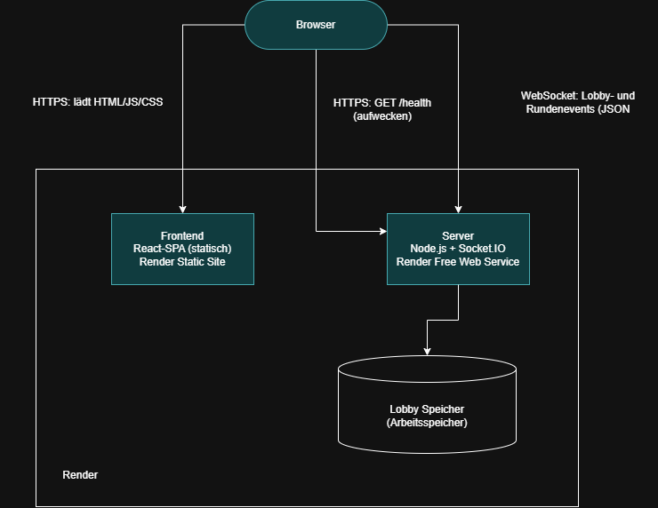
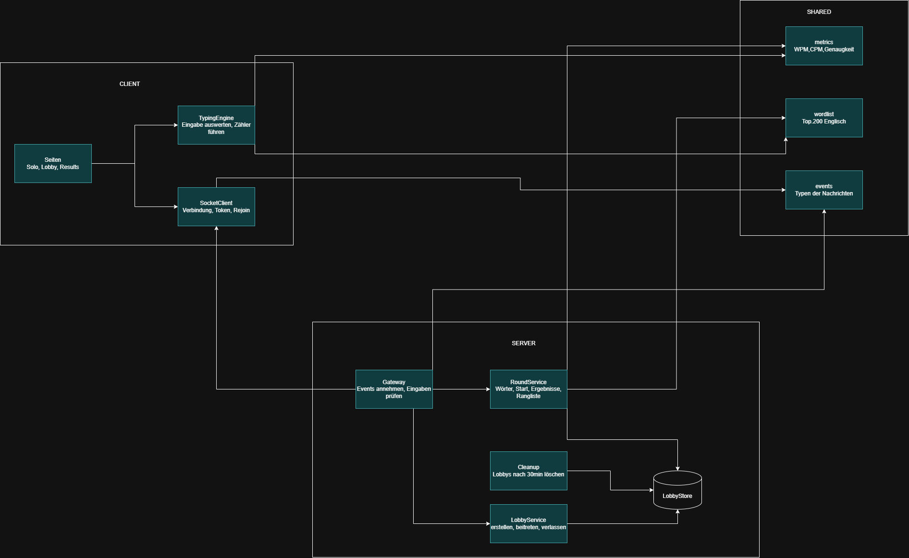
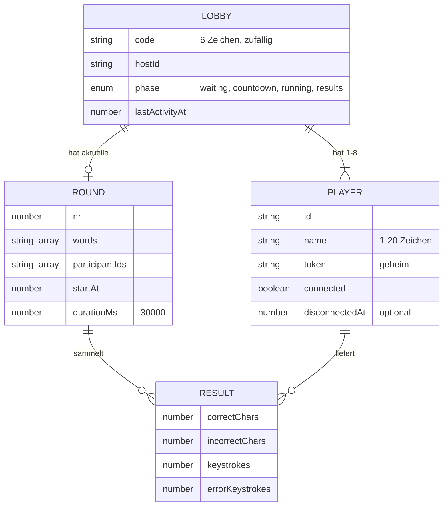
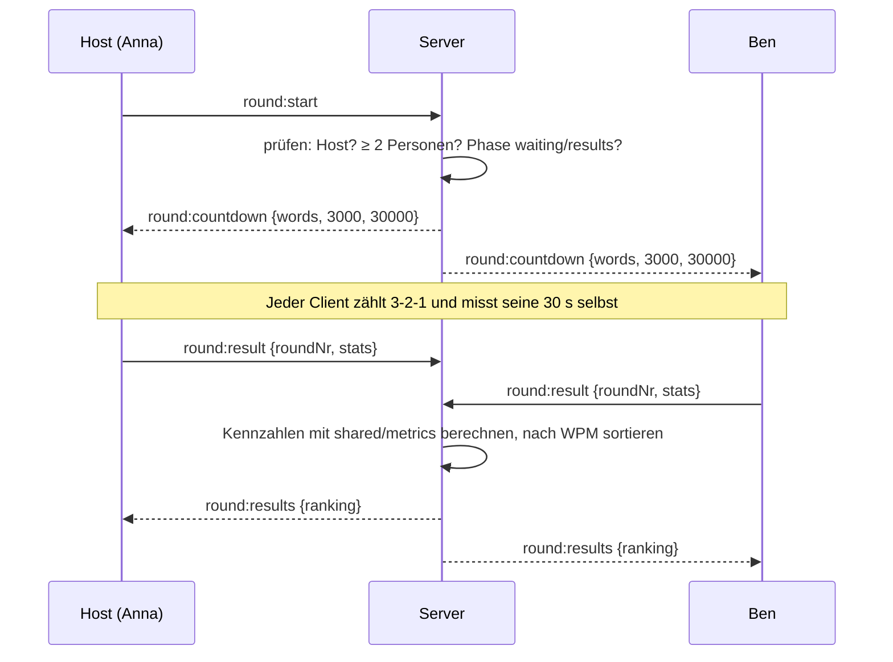

# Architektur – KeyDuel

## 1. Überblick

KeyDuel ist eine Web-App zum Tippen-Üben, alleine oder gegen Freunde. Die Architektur folgt der Kernidee **„sofort spielen, ohne Anmeldung“**:

- Der **Einzelspieler** läuft vollständig im Browser. Er braucht keinen Server und startet ohne Wartezeit.
- Der **Multiplayer** läuft über einen kleinen **Node.js-Server (Monolith)**, der Lobbys und Runden per WebSocket verwaltet. Er hält alle Daten nur im Arbeitsspeicher.
- Frontend und Server werden **getrennt gehostet**, beide kostenlos bei Render ([hosting.md](hosting.md)).

Wichtige Entscheidungen:
- [ADR 0001 – Monolith statt Backend-as-a-Service oder Peer-to-Peer](adr/0001-monolith.md)
- [ADR 0002 – Keine Datenbank, Lobbys im Arbeitsspeicher](adr/0002-keine-datenbank.md)

## 2. Anforderungen mit Einfluss auf die Architektur

| Anforderung | Folge für die Architektur |
|---|---|
| US-01–03, NFR-01 (Markierung ≤ 50 ms) | Die Tipp-Logik läuft lokal im Browser, ohne Server-Anfrage pro Tastendruck. |
| US-04/05, NFR-02 (≤ 2 s) | Ein Echtzeit-Kanal (WebSocket) vom Server zu allen in der Lobby |
| US-05, FR-06 (nur der Host startet, max. 8, gleiche Wörter) | Der Server ist die Autorität und setzt die Regeln durch. |
| NFR-04 (nur Name, Löschung nach 30 min) | Keine Datenbank, alles im Arbeitsspeicher |
| NFR-05 (Unit-Tests der Formeln) | Die Formeln liegen in einem eigenen Modul ohne UI und ohne Netzwerk. |
| NFR-06 (gratis) | Ein Server, keine kostenpflichtigen Fremddienste |

## 3. Architekturvarianten

| Kriterium | **A: Monolith** ✅ | B: Backend-as-a-Service | C: Peer-to-Peer |
|---|---|---|---|
| Aufbau | ein Node-Server mit WebSockets, Daten im Speicher | statisches Frontend + Echtzeit-DB (z. B. Firebase), keine eigene Server-Logik | Browser des Hosts hält den Zustand, WebRTC |
| Regeln durchsetzen | ✅ im Server-Code | ⚠️ über Security Rules des Anbieters | ❌ im Host-Browser, manipulierbar |
| NFR-04 Löschen | ✅ automatisch | ⚠️ Cleanup-Job nötig | ✅ |
| NFR-06 gratis | ✅ | ✅ | ⚠️ TURN-Server meist kostenpflichtig |
| Testbarkeit | ✅ normale Unit-Tests | ⚠️ | ❌ |
| Kaltstart | ⚠️ Server schläft im Gratis-Tarif, gelöst durch getrenntes Frontend | ✅ keiner | – |
| Risiko für das Team | mittel (nur Echtzeit neu) | mittel (neuer Dienst, neue Regel-Sprache) | hoch |

Microservices wurden nicht weiter betrachtet: Bei maximal 8 Personen pro Lobby gibt es nichts, was einzeln skaliert werden müsste.

**Entscheidung: Variante A.** Die Begründung steht in [ADR 0001](adr/0001-monolith.md).

## 4. Technologien

| Bereich | Wahl | Begründung |
|---|---|---|
| Sprache | **TypeScript** (Client, Server, Shared) | Eine Sprache für alles. Formeln und Nachrichtentypen werden geteilt, Typfehler fallen früh auf. |
| Frontend | **React** mit **Vite** | Das Team kennt React. Vite baut schnell und erzeugt statische Dateien für das Hosting. |
| Echtzeit | **Socket.IO** | Bringt Rooms, automatischen Reconnect und Antworten auf Nachrichten (Acks) mit. Damit ist unser größtes Risiko (Echtzeit) mit möglichst wenig eigenem Code abgedeckt. |
| Server | **Node.js** mit Socket.IO | Der Server liefert nur WebSockets und `/health` aus. Ein Web-Framework wie Express ist nicht nötig. |
| Persistenz | **keine** | Siehe [ADR 0002](adr/0002-keine-datenbank.md). |
| Tests | **Vitest** | Passt zu Vite und läuft für alle drei Pakete gleich. |
| Repo | **npm Workspaces**: `client/`, `server/`, `shared/` | `shared` wird von Client und Server ohne Kopieren genutzt. |
| Hosting | **Render** (Static Site + Free Web Service) | Siehe [hosting.md](hosting.md). |

## 5. Architekturdiagramme (C4)

### Ebene 1: Kontext

📄 [Kontextdiagramm (PDF)](../assets/Kontext_KeyDuel.pdf)

Drei Personengruppen nutzen KeyDuel: Spieler:innen, die alleine üben oder eine Lobby erstellen, Mitspieler:innen, die per Link beitreten, und Tastatur-Tester:innen, die nur alleine üben. KeyDuel hat keine externen Systeme: keine Anmeldung, keine Datenbank, keine Fremd-APIs.

### Ebene 2: Container



| Container | Technologie | Kommunikation |
|---|---|---|
| Frontend | React-SPA, Render Static Site | Browser lädt HTML/JS/CSS per HTTPS |
| Server | Node.js + Socket.IO, Render Free Web Service | `GET /health` zum Aufwecken, WebSocket für Lobby- und Runden-Events (JSON) |
| Lobby-Speicher | Arbeitsspeicher des Servers | nur vom Server genutzt |

Das Frontend ruft den Server nur für den Multiplayer auf. Der Einzelspieler funktioniert auch, wenn der Server schläft.

### Ebene 3: Komponenten



Das Diagramm zeigt die drei Pakete `client` (Seiten, TypingEngine, SocketClient), `shared` (metrics, wordlist, events) und `server` (Gateway, LobbyService, RoundService, Cleanup, LobbyStore). Die Verantwortlichkeiten stehen in Abschnitt 6.

Innen ist der Server in Schichten aufgebaut: **Gateway** (Transport) → **Services** (Logik) → **Store** (Daten).

## 6. Komponenten und Verantwortlichkeiten

| Komponente | Ort | Verantwortung |
|---|---|---|
| Seiten (Solo, Lobby, Ergebnis) | client | Anzeige, Routing (`/`, `/lobby/:code`) |
| TypingEngine | client | Tastendrücke auswerten, Zeichen markieren, Zähler führen, Timer |
| SocketClient | client | Verbindung aufbauen, Token im `sessionStorage` halten, nach Abbruch neu beitreten |
| metrics | shared | Reine Funktionen für WPM, CPM, Genauigkeit (NFR-05) |
| wordlist | shared | Wortliste und zufällige Wortfolge (FR-02) |
| events | shared | TypeScript-Typen aller Nachrichten zwischen Client und Server |
| Gateway | server | Events annehmen, Eingaben prüfen, Fehlercodes zurückgeben |
| LobbyService | server | Lobby erstellen und beitreten, Host-Rechte prüfen, Gnadenfrist bei Verbindungsabbruch |
| RoundService | server | Wörter erzeugen, Countdown senden, Ergebnisse sammeln, Rangliste bilden |
| LobbyStore | server | Map `Lobby-Code → Lobby` |
| Cleanup | server | Lobbys nach 30 min Inaktivität löschen (NFR-04) |

## 7. Datenmodell

Alle Daten liegen nur im Arbeitsspeicher des Servers ([ADR 0002](adr/0002-keine-datenbank.md)). Der Einzelspieler hält seine Daten nur im Browser.



```ts
// shared/src/types.ts
export type Phase = 'waiting' | 'countdown' | 'running' | 'results';

/** Zähler einer Tipprunde. Grundlage für alle Kennzahlen. */
export interface TypingStats {
  correctChars: number;    // richtige Zeichen im Endtext (inkl. Leerzeichen)
  incorrectChars: number;  // falsche Zeichen im Endtext
  keystrokes: number;      // alle Anschläge ohne Backspace
  errorKeystrokes: number; // falsche Anschläge, auch wenn später korrigiert
}

export interface Player {
  id: string;
  name: string;
  token: string;            // verlässt den Server nur einmal: an den eigenen Client
  connected: boolean;
  disconnectedAt?: number;  // für die Gnadenfrist von 10 s
}

export interface Round {
  nr: number;
  words: string[];
  participantIds: string[]; // wer beim Start dabei war
  startAt: number;          // Server-Zeit, zu der das Tippen beginnt
  durationMs: number;
  results: Map<string, TypingStats>;
}

export interface Lobby {
  code: string;
  hostId: string;
  players: Map<string, Player>;
  phase: Phase;
  round?: Round;            // nur die aktuelle Runde (Gesamtwertung US-10 ist Should)
  lastActivityAt: number;
}
```

**Kennzahlen** (`shared/src/metrics.ts`, Formeln aus [requirements.md](requirements.md)):

| Kennzahl | Berechnung |
|---|---|
| WPM | `correctChars / 5 / Minuten` |
| CPM | `correctChars / Minuten` |
| Genauigkeit | `(keystrokes − errorKeystrokes) / keystrokes × 100` |

Probe mit dem Testfall aus NFR-05: `thx⌫e cat sat` ergibt 12 Anschläge mit einem Fehler, also 11 / 12 = 91,7 %.

## 8. API-Design

### HTTP (Server)

| Methode | Pfad | Antwort | Zweck |
|---|---|---|---|
| GET | `/health` | `200 { "status": "ok" }` | Server aufwecken, Health-Check für Render |

Das Frontend wird separat ausgeliefert. Render leitet alle Pfade (z. B. `/lobby/AB12CD`) auf `index.html` um, das Routing übernimmt React.

### WebSocket-Events (Socket.IO, JSON)

Jede Anfrage vom Client bekommt eine Antwort (Ack) im Format
`{ ok: true, ...daten }` oder `{ ok: false, error: Fehlercode }`.

**Client → Server**

| Event | Payload | Antwort bei Erfolg | Fehlercodes |
|---|---|---|---|
| `lobby:create` | `{ name }` | `{ code, playerId, token }` | `INVALID_NAME` |
| `lobby:join` | `{ code, name }` | `{ playerId, token }` | `NOT_FOUND`, `FULL`, `INVALID_NAME` |
| `lobby:rejoin` | `{ code, token }` | `{ playerId }` | `NOT_FOUND`, `INVALID_TOKEN` |
| `lobby:leave` | `{}` | `{}` | – |
| `round:start` | `{}` | `{}` | `NOT_HOST`, `NOT_ENOUGH_PLAYERS`, `WRONG_PHASE` |
| `round:result` | `{ roundNr, stats: TypingStats }` | `{}` | `WRONG_ROUND`, `NOT_PARTICIPANT`, `TOO_LATE` |

**Server → alle in der Lobby**

| Event | Payload | Wann |
|---|---|---|
| `lobby:state` | `{ code, phase, hostId, players: [{ id, name, connected }] }` | bei jeder Änderung der Lobby |
| `round:countdown` | `{ roundNr, words, countdownMs: 3000, durationMs: 30000 }` | Host startet die Runde |
| `round:results` | `{ roundNr, ranking: [{ playerId, name, wpm, cpm, accuracy, correctChars, incorrectChars }] }` | alle Ergebnisse da oder Frist abgelaufen |
| `lobby:closed` | `{ reason: 'HOST_LEFT' \| 'INACTIVE' }` | Lobby wird aufgelöst |

### Ablauf einer Runde



**Warum misst jeder Client die Zeit selbst?** Netzwerk-Latenz verschiebt dann nur den Start, nicht die Länge der Runde. Jede Person hat genau 30 s, das Ergebnis bleibt fair.

## 9. Regeln für Sonderfälle

| Fall | Verhalten |
|---|---|
| Ergebnisse sammeln | Der Server wartet, bis alle Teilnehmenden ihr Ergebnis geschickt haben, höchstens aber bis Start + 3 s + 30 s + 5 s Puffer. Wer bis dahin nichts geschickt hat, steht ohne Wertung am Ende der Rangliste. |
| Gleichstand bei WPM | Die höhere Genauigkeit gewinnt. |
| Verbindungsabbruch (alle) | Die Person bleibt 10 s als „getrennt“ in der Lobby. Mit `lobby:rejoin` und dem Token aus dem `sessionStorage` kehrt sie zurück. Danach wird sie entfernt. |
| Verbindungsabbruch des Hosts | Wie oben. Kommt der Host nicht innerhalb von 10 s zurück, endet die Lobby für alle (`lobby:closed`, `HOST_LEFT`). |
| Host verlässt die Lobby aktiv | Die Lobby endet sofort. |
| Beitritt während einer laufenden Runde | Erlaubt. Die Person steht nicht in `participantIds` und spielt ab der nächsten Runde mit. |
| Keine Aktivität für 30 min | Cleanup löscht die Lobby (`lobby:closed`, `INACTIVE`). |

## 10. Nichtfunktionale Anforderungen

**Performance**
- NFR-01: Die Auswertung jedes Tastendrucks erfolgt lokal in der TypingEngine, ohne Netzwerk.
- NFR-02: Socket.IO überträgt Ereignisse sofort. Der Server steht in Frankfurt. Der Kaltstart betrifft nur den ersten Aufruf und wird durch `/health` beim Laden der Seite abgefedert ([hosting.md](hosting.md)).

**Security**
- Lobby-Codes und Tokens werden mit `crypto` erzeugt. Ein Code hat 6 Zeichen aus 32, das sind ca. 1 Mrd. Möglichkeiten.
- Host-Rechte werden auf dem Server über die Socket-Verbindung geprüft, nie über Angaben des Clients.
- Alle Eingaben werden im Gateway geprüft (Name 1–20 Zeichen, Typen und Grenzen der Zähler). Socket.IO begrenzt die Nachrichtengröße (`maxHttpBufferSize`).
- CORS erlaubt nur die Domain des Frontends.
- Namen werden von React automatisch escaped, also kein XSS.

**Datenschutz (NFR-04)**
- Gespeichert wird nur der Anzeigename, und nur im Arbeitsspeicher. Es gibt keine Logs mit Namen.
- Lobbys werden nach 30 min Inaktivität gelöscht.

**Wartbarkeit**
- Eine Sprache, drei klar getrennte Pakete. Die Nachrichtentypen sind geteilt, deshalb meldet der Compiler Abweichungen zwischen Client und Server.
- Formeln und Lobby-Logik sind ohne Browser und Netzwerk testbar.

## 11. Bewusst akzeptierte Risiken

| Risiko | Warum akzeptiert |
|---|---|
| **Schummeln:** Clients melden ihre Zähler selbst. | Zielgruppe sind Freundesgruppen. Ganz verhindern lässt sich Schummeln im Browser ohnehin nicht. Eine einfache Plausibilitätsprüfung (z. B. WPM-Obergrenze) ließe sich später mit wenig Aufwand ergänzen. |
| Neustart des Servers löscht alle Lobbys | Lobbys sind kurzlebig. Man erstellt einfach eine neue. |
| Kaltstart des Gratis-Servers (ca. 1 min) | Betrifft nur den Multiplayer. Plan B steht in [hosting.md](hosting.md). |

## 12. Erweiterbarkeit (Should-Stories)

Die Should-Stories passen ohne Umbau in die Architektur:

| Story | Änderung |
|---|---|
| US-06 Testdauer | `durationMs` existiert bereits, nur die Auswahl in der UI fehlt. |
| US-07 Sprache/Schwierigkeit | Weitere Wortlisten in `shared/wordlist` |
| US-08 Live-Fortschritt | Neues Event `round:progress` (Client → Server → alle) |
| US-09 Personen entfernen | Neues Event `lobby:kick { playerId }`, nur für den Host |
| US-10 Gesamtwertung | `round` wird zu `rounds: Round[]` |

## 13. Projektstruktur

```
client/          React-App (Vite)
  src/pages/     Solo, Lobby, Ergebnis
  src/typing/    TypingEngine
  src/net/       SocketClient
server/          Node.js + Socket.IO
  src/gateway.ts
  src/lobby/     LobbyService, LobbyStore, Cleanup
  src/round/     RoundService
shared/          von Client und Server genutzt
  src/metrics.ts
  src/wordlist.ts
  src/events.ts
  src/types.ts
```
